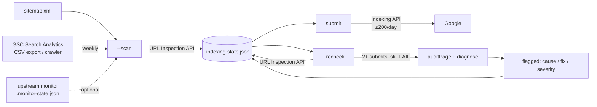

# Search Console Indexing Automation

A Node.js tool that finds the pages Google hasn't indexed, submits them through the Indexing API within the daily quota, and works out from evidence why the ones that still don't index are failing.

## Problem

A Shopify store with several hundred products, collections and blog posts had a large, growing "Crawled – currently not indexed" bucket in Google Search Console. The GSC UI shows that bucket, but it doesn't help you work through it: you inspect one URL at a time, the export is capped, and nothing tells you whether a page is failing because of a technical blocker, a canonical conflict, or plain low quality. Re-requesting indexing by hand doesn't scale, and pinging the same URL over and over does nothing.

## What it does

- **Scan**: builds the URL inventory from the sitemap (including nested sitemap indexes). Weekly, it also adds pages from Search Analytics, a GSC CSV export and a shallow internal-link crawl. Each new URL goes through the URL Inspection API and is classified as indexed, not indexed or skipped.
- **Submit**: sends not-indexed URLs to the Indexing API (`URL_UPDATED`), staying within the 200/day quota. URLs submitted more than 7 days ago that are still unindexed are re-submitted, up to a cap of 3 per URL.
- **Recheck**: re-inspects submitted URLs. Indexed ones are moved out of the queue. A URL submitted 2+ times that still isn't indexed is flagged, and the tool fetches the live page to diagnose a root cause.
- **Diagnose**: a rule set that checks HTTP status, redirects, `noindex` (meta or `X-Robots-Tag`), robots.txt, user-declared vs Google-selected canonical, fetch state, crawl history, word count and duplicate-slug patterns. For each flagged URL it returns a cause, a severity and a recommended fix.
- **Report**: a daily summary with day-over-day deltas and flagged URLs grouped by cause, so the output reads as an action list rather than a list of URLs.

## How it works



| File | Role |
|---|---|
| `src/gsc-indexing.js` | CLI and state machine: scan, submit, recheck, status, single-URL submit |
| `src/gsc-lib.js` | URL allowlist, inspection-result parser, live page audit, diagnosis rules |

## Design decisions

- **Auth**: a Google service account with the `indexing` and `webmasters.readonly` scopes, via `google-auth-library`. No OAuth consent flow, so it runs unattended in CI or cron. The service account is added as an Owner on the GSC property.
- **Quota-aware batching**: daily counters for submissions (200) and inspections (2,000) live in the state file and reset by date. A `429` stops the run cleanly rather than retrying in a loop. Each run sends the next slice, and leftover URLs carry over to the next day.
- **Stop re-pinging dead ends**: each URL tracks a `submitCount`. Once a URL reaches `MAX_SUBMITS_PER_URL` it is no longer submitted and stays flagged until someone fixes the page. Repeated submission of a page Google has decided not to index burns quota and changes nothing.
- **Evidence over guesswork**: the diagnosis combines the full Inspection API payload (coverage state, both canonicals, robots and fetch state, last crawl) with a live fetch of the page, and checks hard blockers before quality signals. URLs that are non-indexable by design, such as redirects or canonicalised variants, are untracked automatically.
- **Allowlist, not denylist**: `isIndexablePageUrl` admits only the homepage and `/products|collections|blogs|pages/` URLs on the configured host with no query string. This came from experience: CDN image URLs and `?variant=` links from Search Analytics had leaked into the queue and were using up quota. On load, the state file is cleaned against the same filter.
- **Idempotent and resumable**: state is written after every API call, so a crash or timeout loses at most one URL's work. Re-running a mode is safe.
- **Dry run**: `--dry-run` prints the batch that would be submitted without calling the Indexing API.
- **Re-diagnosis**: stored diagnoses expire after 14 days, so a page that has been fixed gets re-evaluated rather than keeping a stale label.

> A note on the Indexing API: Google officially supports it only for `JobPosting` and `BroadcastEvent` pages. Here it was used as a best-effort crawl hint next to sitemaps and internal linking, not as a guarantee. Most of the value came from the diagnosis loop.

## Setup

```bash
npm install
cp .env.example .env            # set GSC_SITE_URL, SHOPIFY_STORE, key path
# place your service-account JSON at the path in GOOGLE_SERVICE_ACCOUNT_PATH

npm run scan        # light: sitemap (+ monitor state if present)
npm run scan:full   # weekly: + Search Analytics, crawler, ./gsc-not-indexed.csv
npm run submit:dry  # preview today's batch
npm run submit      # submit up to the daily quota
npm run recheck     # re-inspect submitted URLs, flag + diagnose stragglers
npm run status      # print the report
node src/gsc-indexing.js --submit-url https://example.com/products/sample-product
```

Requires Node 18+ (uses built-in `fetch` and `AbortSignal.timeout`). In production it ran on a daily schedule (scan, then submit, then recheck), with the state file kept between runs.

---

Extracted from a production SEO pipeline I built for a live e-commerce business, 2026.

© Michael Wootan. Source shared for portfolio review; all rights reserved.
